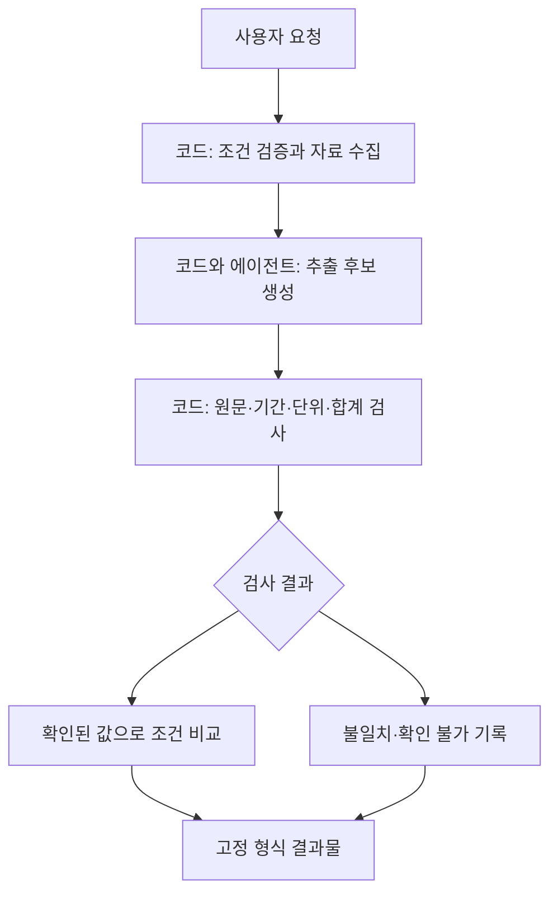

# 구조와 판단 경계

상태: 개념 설명. 아래 상자는 구현 패키지나 배포 서비스의 확정안이 아닙니다.

## 경계

| 코드 | 에이전트 |
|---|---|
| 입력 규격·실행 순서·계산·출력 통제 | 복잡한 머리글·문장·항목의 의미 해석 |
| 근거 위치·원문 값 등 검사 | 근거와 해석을 후보로 반환 |
| 상태와 실패 기록 | 불명확할 때 판단 보류 |

검사를 통과했다는 사실이 모든 의미상 오류의 부재를 보장하지는 않습니다. 실제 공시 정답 사례를 통해 별도 평가해야 합니다.

## 자료의 재사용

원문 자료와 추출 결과를 구분합니다. 원문 캐시는 중복 다운로드를 줄이고 재분석을 돕습니다. 추출 규칙이 바뀌면 저장된 결과의 재사용 가능 여부를 따져야 합니다. 공시 목록에는 새 자료와 정정이 생길 수 있습니다. 구체적인 캐시 정책은 앞으로 결정합니다.

## 조회 유형별 분기 — 설계 단계

[조회 유형 명세](query-types.md)를 기준으로 공통 수집·근거·단위·기간·결과 기록을 재사용하고, 유형별로 찾을 사실·입력/결과 계약·판정 책임을 나눕니다. 에이전트는 허용된 조회 유형에 맞는 후보를 찾고 코드는 계약·계산·실패를 통제합니다. 등록형 모듈이나 복잡한 플러그인 엔진·자동 조합·라우터는 아직 만들지 않았습니다. 현금 파서를 다른 조회의 만능 파서로 취급하지 않습니다.
