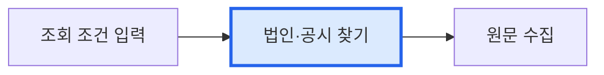

# 원본·정정 연결 근거 대조

## 한 줄 요약

준비한 원본·정정 근거가 수집 목록과 같은 법인·보고기간·공시를 가리키는지 검사합니다. 정정 관계 자동 발견과 적용할 금액 선택은 아직 하지 않습니다.

## 지도에서의 위치

B 단계의 연결 근거 검사이며 일부 상태를 유지합니다.

## 무엇이 달라졌나

다른 법인·사업기간·접수번호·최초 제출일·정정 원문 해시가 섞이면 입력을 거절합니다. 근거 없음·공시 마감 이후·같은 날 순서 불명은 확인 필요로 남깁니다. 근거가 맞아도 기존 후보 선택기는 여러 후보를 계속 보류합니다.

## 누가 무엇을 정했나

**기존 docs와 사용자가 정한 것**

- 원문·정정표와 명시적 관계 근거를 대조하고 제목·날짜·같은 금액만으로 정정 적용을 추정하지 않습니다.

**구현 중 에이전트가 정한 것**

- 사업기간이 있는 재무 후보 두 건의 입력 계약부터 구현했습니다. 사건·다중 차수·철회·첨부 병합은 이번 범위에 넣지 않았습니다.
- 전체 문서 해시와 뷰어 응답 해시를 별도 필드로 보존합니다. 결과는 메타데이터 일치이며 의미 검증 완료나 최신본 선택으로 표시하지 않습니다.
- 뷰어 근거는 원본 접수번호의 공식 main.do 주소만 받으며 추가 파라미터는 거절합니다. 원문 자동 수집기는 아닙니다.

## 확인해 주세요

추가 결정은 없습니다. 기존 후보 보류와 정답을 유지합니다. 정정이 조회 항목에 미친 영향·유효 순서 확인과 실제 자동 연결은 다음 범위입니다.

## 확인한 것과 못 한 것

| 확인한 것 | 못 한 것 |
|---|---|
| HD건설기계 개발용 원문 기록으로 준비한 두 후보의 연결 근거 대조 | 새로운 법인·다른 정정 양식에서 근거 자동 추출 |
| 다른 법인/기간/접수/최초일/원문 해시·마감·근거 누락 방지 | 입력한 근거 문장의 진실성·정정 유효성·전체 차수 |
| 기존 후보 선택의 복수 후보 보류 유지 | 항목 불변 추정·최신 정정 금액 자동 적용 |

목록 행은 기존 원문 메타데이터로 구성한 합성 입력입니다. 실제 list.json 응답을 재현한 테스트로 표현하지 않습니다.

## 근거

- PR: [#89](https://github.com/YUJAEYUN/Dartness/pull/89) · 이슈: [#88](https://github.com/YUJAEYUN/Dartness/issues/88)
- [계약](../specs/correction-evidence.md), [기존 조사](../design/correction-linking.md), [개발용 정답 사례](../cases/hd-construction-correction.md)
- 구현: src/dartness/correction_evidence.py · 검사: tests/test_correction_evidence.py
