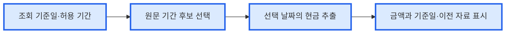

# 원문의 당기·과거 열을 조회 기준일에 맞게 선택

## 한 줄 요약

저장된 공시의 기간별 현금 근거를 공통 선택 계약에 연결하고 요청 기준일에 맞는 열로 금액 조건을 비교합니다.

## 지도에서의 위치

제공된 보고서 묶음 안의 연결이며 전수·최신 정정 완료를 뜻하지 않습니다.

## 무엇이 달라졌나

당기·전기·전전기의 실제 기간과 현금 셀을 읽어 공통 후보를 만듭니다. 기존 최신/지정일·허용 개월·마감·동률 보류 계약을 재사용합니다. 실패 보고서를 빼고 오래된 자료를 택하지 않으며 단일 정정 표시도 관계 확인 전에는 보류합니다. 선택한 실제 날짜와 원래 요청은 구분해 엑셀·내부 JSON에 보존합니다.

## 누가 무엇을 정했나

사용자가 이슈 #94 진행을 승인했습니다. 에이전트는 기존 계약과 추출/금액/출력을 연결했습니다. 별도/개별은 기존처럼 상위 단계에서 확인해 전달하고 BS_S만으로 추론하지 않습니다. 새 의존성·선정 기준·기존 정답·CI 완화는 없습니다.

## 확인해 주세요

추가 결정은 없습니다. 비교기간 중 한 열이라도 읽지 못하면 이번 지원 범위에서는 전체 묶음을 확인 필요로 둡니다. 전수·유효 정정·범위 자동 판정은 다음 연결 과제입니다.

## 확인한 것과 못 한 것

대한약품 원문의 2025/2024/2023년 말 현금과 요청 날짜·이전 자료 표시를 대조했습니다. 개발용 사례입니다. 별도 회사인 이크레더블의 기존 공개 원문 세 기간은 연결 로직 수정 없이 추가 점검했지만 기존 추출 평가 자료이므로 미사용 E2E 검증이라고 부르지 않습니다. 실패·동률·정정 미확인·공시 마감·다른 법인/범위를 변형/합성 검사로 구분합니다. 모든 공시 서식과 최종 전수 엑셀은 미검증입니다.

## 근거

- [PR #100](https://github.com/YUJAEYUN/Dartness/pull/100), [이슈 #94](https://github.com/YUJAEYUN/Dartness/issues/94)
- [후보 연결](../specs/cash-report-slice.md#report-candidates), [공통 계약](../specs/common-query-contract.md)
- src/dartness/cash_report_candidates.py · src/dartness/cash_snapshot.py · tests/test_cash_snapshot.py
