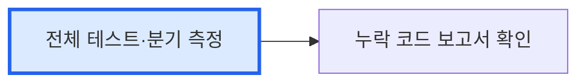

# Python 테스트의 미실행 분기 확인

## 한 줄 요약

기존 전체 테스트에 커버리지 측정을 연결해 실행하지 않은 제품 코드와 분기를 확인합니다.

## 지도에서의 위치

## 무엇이 달라졌나

code-quality에서 src/dartness 전체의 커버리지를 측정하고 HTML·XML·JSON 보고서를 7일 보관합니다. 테스트가 가져오지 않은 모듈도 포함합니다. 기존 테스트 실패는 계속 CI 실패입니다.

## 누가 무엇을 정했나

사용자가 커버리지 도입 방향과 개발 의존성 추가에 동의했습니다. pytest-cov와 Coverage.py만 추가하며 기존 검사·정답·권한을 유지합니다. 커버리지 합격선이나 추가 제외는 없습니다.

## 확인해 주세요

추가 결정 요청은 없습니다. 외부 서비스 전송은 없고, 변이 테스트 확대·별도 세션 리뷰·훅 확대는 이번 변경에 포함하지 않았습니다.

## 확인한 것과 못 한 것

실행 결과는 PR과 이슈에 기록합니다. 커버리지는 실행 여부를 확인하며 기대값의 정확성이나 테스트의 오류 탐지 능력을 보장하지 않습니다. 공시 원문 기반 정답과 기존 수동 변이 테스트를 함께 유지합니다.

## 근거

- [PR #113](https://github.com/YUJAEYUN/Dartness/pull/113), [이슈 #112](https://github.com/YUJAEYUN/Dartness/issues/112)
- [커버리지 실행·해석](../guides/testing.md#coverage), [CI](../guides/ci.md)
- pyproject.toml, requirements-dev.txt, .github/workflows/code.yml
