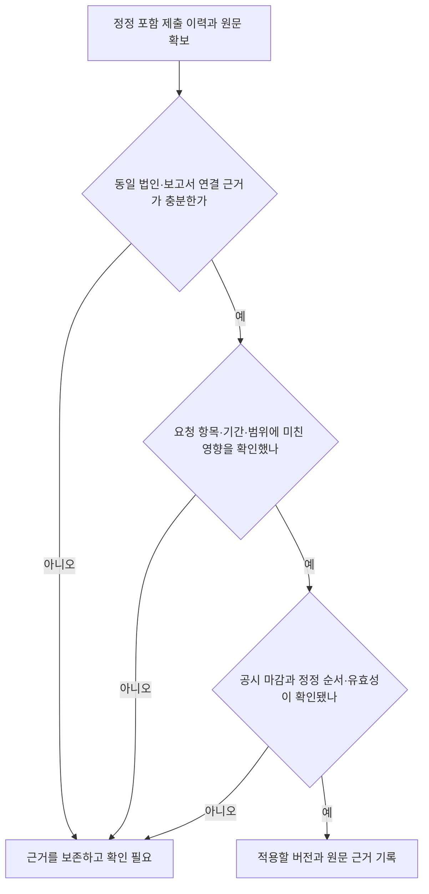

# 원본·정정공시 연결 근거와 구현 준비

상태: 2026-11-23 공식 문서와 실제 공시 한 쌍을 조사했습니다. 최신 유효 정정 반영은 합의한 정책입니다. 아래는 그 정책을 구현하기 위한 근거와 검증 계획이며, 자동 연결·정정 선택 코드는 아직 없습니다. 후속 [전체 PDF·XBRL 개발용 사례](../cases/hd-construction-correction.md)에서는 원문을 확보하고 현금 두 셀을 추가 대조했습니다. 현재 실행 가능한 경계는 [공시 후보 계약](../specs/common-query-contract.md)의 복수 후보 보류입니다.

## 무엇을 확인했나요?

| 공식 출처 | 확인한 정보 | 이것만으로 알 수 없는 것 |
|---|---|---|
| [OpenDART 공시검색](https://opendart.fss.or.kr/guide/detail.do?apiGrpCd=DS001&apiId=2019001) | last_reprt_at=N은 정정 포함 이력을 조회. 보고서명은 기재정정·첨부정정·첨부추가 등을 구분하고 rm의 정은 후속 정정이 있다는 표시 | 공개된 응답 필드 목록에는 원본 접수번호를 직접 가리키는 관계 필드가 없음. 관련 항목·기간·유효한 정정 차수를 확정할 수 없음 |
| [OpenDART 원문 파일](https://opendart.fss.or.kr/guide/detail.do?apiGrpCd=DS001&apiId=2019003) | 접수번호로 해당 공시 ZIP을 요청 | 원본과 정정의 연결 관계를 대신 반환하는 API라는 설명은 없음 |
| [DART 회사별 검색 안내](https://dart.fss.or.kr/guide/main.jsp?menu=121) | 최종보고서 선택을 해제하면 이전 제출 이력도 볼 수 있고 정정 종류를 구분함 | 최종본 필터만으로 조회 항목의 변경 내용·과거 공시 마감에 맞는 버전을 증명할 수 없음 |

검색 API의 rm=정은 **현재 문서가 정정본이라는 뜻과 다릅니다.** 보고서명 표시는 정정 유형의 단서이며, 정정 명령·제출 요구가 있다고 정정된 수치가 이미 제출됐다고 간주하지 않습니다. last_reprt_at=Y를 쓰는 것만으로 항목별 연결·원문 검증이 끝났다고 하지 않습니다.

설계 방향은 이력 검색(N)과 원문·정정표를 대조하는 것입니다. 기존 평가 수집기는 정정 전 원본을 모으는 별도 목적이므로 변경하지 않습니다. 공식 가이드의 모든 API에 연결 정보가 없다고 결론 낸 것은 아닙니다. 이번에 확인한 공시검색·원문 API의 범위입니다.

## 실제 사례: HD건설기계 사업보고서

공시 뷰어와 원본 표지·정정표를 직접 확인했습니다. 이 사례는 이미 읽었으므로 개발용 조사 자료이며 미사용 검증용이 아닙니다.

| 항목 | 확인 내용·근거 |
|---|---|
| 법인 | 두 뷰어의 법인 코드 01205842, 표시명 HD건설기계 |
| 원본 | [20260318001192](https://dart.fss.or.kr/dsaf001/main.do?rcpNo=20260318001192), 2026-03-18 제출 |
| 정정 | [20260602000456](https://dart.fss.or.kr/dsaf001/main.do?rcpNo=20260602000456), 2026-06-02 제출 |
| 원본 사업기간 | 2025-01-01 ~ 2025-12-31, 원본 표지에서 확인 |
| 정정의 대상 | 정정표의 대상 서류는 사업보고서, 최초 제출일은 2026-03-18 |
| 추가 연결 근거 | 두 뷰어의 본문 선택 목록에 위 원본·정정 접수번호가 함께 표시됨. 첨부 목록과 구분 |
| 정정 사항 | 연결재무제표 주석의 연결대상기업 개요에서 태깅 방식을 변경했다고 기재 |
| 조사 당시 미확인 | 당시 현금 변경·불변은 미확인. 후속 [개발용 사례](../cases/hd-construction-correction.md)에서 2025-12-31 재무상태표의 연결·별도 두 셀은 동일함을 확인. 전체 본문·첨부의 영향과 모든 정정 유형은 여전히 미검증 |

법인·최초 제출일·서류 종류와 공식 뷰어의 연결 표시가 함께 맞는 사례입니다. 제목·날짜가 비슷하다는 이유만으로 짝지은 것이 아닙니다. 뷰어의 관련 목록은 연결 근거 중 하나지만 단순히 목록에 같이 있는 첨부문서나 다른 보고서를 전부 동일 본문 버전으로 취급하지 않습니다.

원문 URL·수집 시각·응답 해시는 [관찰 기록](../research/hd-construction-correction.json)에 있습니다. [정정표 응답](../research/hd-construction-20260602-errata.html.gz)은 HTML 원문 바이트와 줄바꿈을 바꾸지 않고 gzip으로 보존했습니다. 압축을 푼 응답 해시와 압축 파일 자체 해시를 구분해 기록했습니다. 해시는 해당 뷰어 페이지·선정 구간의 응답 해시이며 **전체 OpenDART XML·ZIP 해시가 아닙니다.** 기존 CandidateSource.document_sha256에 이 구간 해시를 대신 넣지 않습니다.

뷰어의 report/viewer.do와 본문 선택 목록 구조는 이번에 관찰한 웹 화면 인터페이스입니다. 공식 OpenDART 관계 API로 확정하거나 안정적인 파서 계약이라고 주장하지 않습니다. 위치 인자는 문서별로 달라지므로 위 사례의 값을 다른 보고서에 재사용하지 않습니다.

## 연결 확인과 항목 적용을 나눕니다

이 흐름은 후속 구현의 명세이며 현재 실행되는 연결기가 아닙니다.

1. **동일 보고서를 확인합니다.** 법인 코드·서류 종류·사업기간 또는 사건 식별을 대조합니다. 정정표의 대상 서류·최초 제출일과 뷰어의 명시적 연결 등 근거 위치를 남깁니다. 최초 제출일과 제목만 같지만 원본 후보가 여러 개면 확정하지 않습니다.
2. **정정이 닿는 내용을 확인합니다.** 본문·첨부 중 무엇을 고쳤는지, 어떤 표·행·기간·별도/연결·통화인지 기록합니다. 정정표에 현금이라는 단어가 없다는 사실만으로 현금 불변을 판정하지 않습니다. 제목의 기재정정·첨부정정 표시만으로 적용할 수치나 범위를 고르지 않습니다.
3. **버전과 공시 마감을 확인합니다.** 실행일까지 공개된 연결된 버전만 사용합니다. 가장 늦은 접수번호·제출일은 순서의 단서이며 유효성 증명이 아닙니다. 같은 날의 차수·부모가 불명확하거나 철회·정정 요구의 영향이 확인되지 않으면 보류합니다. 현재 목록의 표시를 과거 시점에도 같았다고 가정하지 않습니다.
4. **근거와 수치를 함께 남깁니다.** 요청·실제 자료 날짜와 사용한 버전·원본/정정 접수번호·변경 범위·원문 위치를 연결합니다. 여러 버전의 셀을 증거 없이 조립하거나 한 본문의 값처럼 표시하지 않습니다.

변경되지 않은 항목을 어떻게 재사용할지, 첨부정정만 있는 경우 본문과 첨부의 조합을 어떻게 표현할지, 여러 정정의 누적·분기 관계를 어떻게 확정할지는 실제 사례를 더 확보한 뒤 실행 계약으로 정합니다. 이번 단일 사례에서 보편적인 패치 병합 알고리즘을 만들지 않습니다.

## 구현 전에 고정할 검증 사례

아래는 **후속 연결기 테스트의 기대 동작**입니다. 미구현 연결기를 통과한 테스트 수로 집계하지 않습니다. 현재 tests/test_disclosure_candidate.py는 기존 보류·범위·공시 마감 경계를 합성 자료로 검사합니다.

| 사례 구분 | 입력·상황 | 기대 동작 |
|---|---|---|
| 실제 개발용 관찰 | 위 두 접수번호·법인·표지·정정표·본문 선택 목록 | 같은 보고서의 원본·정정 연결 근거를 재현. 현금 영향은 미확인 유지 |
| 합성 계획 | 제목·제출일은 같지만 다른 법인 또는 사업기간 | 연결 거절 |
| 합성 계획 | 최초 제출일·제목이 맞는 원본이 둘 이상 | 원본 연결 확인 필요 |
| 합성 계획 | 단순 정정 표시 또는 최신본 필터만 있고 원문 근거 없음 | 연결·항목 적용을 확정하지 않음 |
| 합성 계획 | 2026-06-02 정정을 2026-05-01 공시 마감에 적용 시도 | 사용 금지. 과거 재무 기준일과 공시 마감은 별개 |
| 합성 계획 | 같은 날짜 여러 차수·원본/정정, 순서나 적용 범위 불명확 | 기존 ambiguous_candidate 보류 유지 |
| 합성 계획 | 정정표에 조회 항목이 없거나 태깅 방식만 언급 | 항목 불변을 추정하지 않음 |
| 합성 계획 | 첨부정정·정정 명령·철회 관련 표시만 있음 | 본문 수치 자동 대체 금지, 관련 원문 확인 필요 |

후속 [개발용 사례](../cases/hd-construction-correction.md)에 전체 본문 PDF·원문 XBRL ZIP과 변경 전후 현금 정답을 고정했습니다. OpenDART 제출서류 XML ZIP 자체를 확보한 것은 아니므로 해당 문서 파서를 검증했다고 하지 않습니다. 이 근거로 명시적 연결·항목 적용 증거를 검증하는 계약을 준비할 수 있습니다. 자동 연결·정정 선택은 아직 없으며 기존 여러 후보 보류를 유지합니다.

## 첫 입력 계약 구현

2026-11-25 [정정 근거 계약](../specs/correction-evidence.md)에서 준비된 원본·정정 후보와 수집 목록·정정표·뷰어 관계의 메타데이터 대조를 구현했습니다. 위 조사의 자동 연결/항목 적용 계획 전체를 구현한 것은 아닙니다. 기존 후보 선택과 정답은 유지하며 실제 원문 의미·최신 차수 유효성·금액 적용은 여전히 후속입니다.

2026-11-25 [현금 두 셀 비교](../specs/correction-cash-comparison.md)를 연결했습니다. 준비된 입력의 출처·범위·정확한 원화 값만 비교하며 정정의 인과·전체 항목 영향·최신본 적용은 아직 하지 않습니다.
