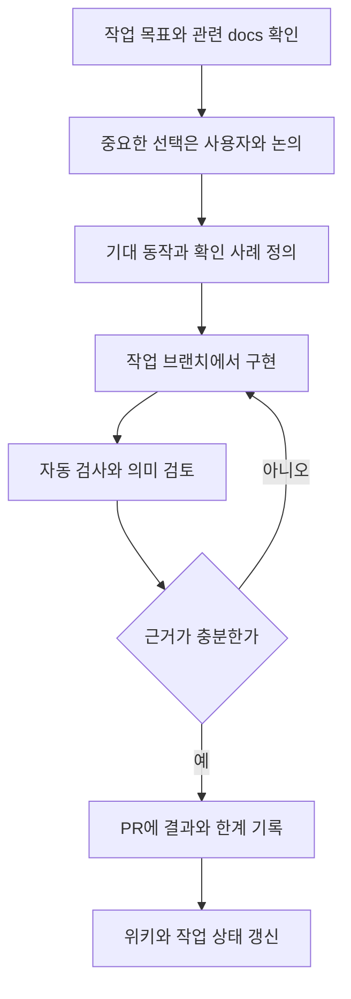

# 개발 작업 흐름

상태: 합의한 운영 방향을 적용하는 첫 버전. 실제 사용에서 불필요한 절차는 줄입니다.

목표는 에이전트가 필요한 기준을 찾고, 결과를 검증하고, 실패한 작업을 복구하며 개발을 이어가는 것입니다. 자체 하네스나 별도 메모리 엔진을 기본 전제로 두지 않습니다.

[다섯 개발 원칙](engineering-principles.md)을 적용합니다. 기능 구현 전 계약·검증 사례를 정하고, 실행 후 조건·결과·미확인 범위를 [평가 기록](record-forms/evaluation.md)에 필요한 만큼 남깁니다.

## 작업 순서

1. **시작:** [작업 상태](work-state.md), [위키](wiki/index.md), 관련 기준 문서를 읽습니다. 합의한 내용·가설·제안을 구분합니다.
2. **목표:** 해결할 문제, 기대 결과, 변경 범위를 정합니다. 중요한 선택은 추천안과 이유를 먼저 제시하고 함께 정합니다. 사소한 구현 선택에는 승인을 반복 요청하지 않습니다.
3. **확인 사례:** [테스트 작성 방법](testing.md)을 따릅니다. 위험과 불확실성에 맞는 사례를 정합니다. 실제 공시의 정답은 원문으로 확인하고 코드 출력으로 만들어내지 않습니다.
4. **구현:** 브랜치에서 하나의 목적을 구현합니다. 현재 필요한 책임부터 나누고 예상만으로 범용 구조를 만들지 않습니다.
5. **검증:** 가능한 자동 검사를 실행하고, [정합성 검토](consistency.md)로 설명과 동작을 대조합니다.
6. **작업 마무리:** PR에 실제 검사 결과와 확인하지 못한 내용을 남깁니다. 기능·명세 PR은 PR을 연 뒤 [작업 브리핑](briefings/index.md)을 같은 PR에 추가합니다. 없으면 CI가 실패합니다. 작업 상태에는 다음 행동을, 위키에는 달라진 참조만 갱신합니다.

## 브랜치와 변경 기록

| 항목 | 사용 방식 |
|---|---|
| main | 검사를 통과한 변경을 PR로 반영하는 기준 브랜치 |
| 작업 브랜치 | docs/주제, feat/주제, fix/주제, chore/주제 |
| 이슈 | 논의가 필요하거나 여러 작업으로 이어질 때 작성. 작은 수정에는 생략 가능 |
| 커밋 | 목적이 드러나는 짧은 한국어. 하나의 논리적 변경 단위 |
| PR | 변경 이유, 관련 docs, 검증, 남은 문제를 설명 |
| 결정 기록 | 영향이 큰 선택의 이유·대안·재검토 조건을 보존 |

타인 승인이나 엄격한 커밋 접두사는 필수화하지 않습니다. [위임 범위](delegation.md)에 따라 일반 작업은 에이전트가 검사 후 병합하고, 기준 변경과 예외는 사용자에게 확인합니다. 중요한 설계 합의는 유지합니다. 이 문서는 운영 규칙이며 저장소 보호 설정을 자동 활성화하지 않습니다.

## 검사와 리뷰

CI는 문서 빌드와 첫 단위 변환 코드의 린트·타입·테스트를 검사합니다. 추가 조회 기능이 생기면 계약·실제 공시 회귀 테스트를 해당 변경에 추가합니다. 실제 API·모델 연동 검사는 외부 장애·비용을 고려해 구분합니다.

테스트 통과가 도메인 정확성을 보장하지는 않습니다. 정답 데이터·기대 결과·검사 제외·CI 완화 변경은 PR에서 이유를 별도로 설명합니다. 관련 실패를 재현하지 않는 약한 테스트나 구현을 그대로 복사한 테스트를 경계합니다.

안티패턴은 실제 문제에서 보강합니다. 실패 사례를 확보하고 원인을 수정한 뒤, 정적 패턴이면 린트·구조 검사로, 동작 문제면 테스트로 남깁니다. 규칙에는 올바른 대안을 함께 안내하고 효과 없는 규칙은 제거합니다. 과도한 추상화는 이름·줄 수만으로 판정하지 않습니다.

## 복구와 관측

Git 차이·커밋·PR·CI 결과와 작업 상태를 우선 활용합니다. 실패 원인과 재시도 결과를 필요한 범위에서 남기되 비밀값·내부 법인 자료·전체 대화를 공개 기록에 복사하지 않습니다. 사용자 변경을 삭제하지 않고, 되돌릴 때는 해당 변경의 영향과 복구 방법을 확인합니다.

## 평가를 분리합니다

| 개발 에이전트 평가 | DART 조회 평가 |
|---|---|
| docs 준수, 회귀, 규칙 우회, 복구와 리뷰 비용 | 법인·문서·기간·단위·금액 정확성, 누락, 잘못된 확정, 보류 |

초기에는 작업별 사례를 기록합니다. 측정할 작업 집합과 정답이 없는 상태에서 성공률이나 신뢰도 점수를 만들지 않습니다. 모델·조건이 다른 실행을 단순 비교하지 않습니다.

## 템플릿

[이슈 템플릿](https://github.com/YUJAEYUN/Dartness/blob/main/.github/ISSUE_TEMPLATE/work.md)과 [PR 템플릿](https://github.com/YUJAEYUN/Dartness/blob/main/.github/pull_request_template.md)은 짧은 안내입니다. 의미 없는 칸은 생략할 수 있습니다. [설계 결정 양식](record-forms/decision.md)은 중요한 선택에만 사용합니다.

## 참고

[dev-notes](https://github.com/YUJAEYUN/dev-notes)의 요구사항 중심·근거 있는 선택·영향에 맞춘 검증 원칙을 이 프로젝트에 필요한 범위에서 적용합니다. 에이전트가 필요한 정보를 찾고 결과를 검증·복구하게 한다는 논의 내용을 운영 흐름으로 구체화했습니다. 논의에서 인용된 출처 불명의 연구 주장은 채택하지 않았습니다.

## 여러 에이전트의 공동 작업

상태: 2026-11-23 사용자와 정했습니다. 여러 에이전트가 동시에 작업합니다. 규칙은 가능한 한 CI와 브랜치 보호로 강제하고, 기계로 판단할 수 없는 것만 아래에 문서로 남깁니다.

### 무엇이 강제되나요?

| 규칙 | 강제하는 장치 | 실패하면 |
|---|---|---|
| 병합 전에 최신 main을 반영합니다 | main 보호의 "병합 전 브랜치 최신화 요구" (사용자가 2026-11-23 켜져 있음을 확인) | GitHub이 병합을 막습니다. main을 합치고 검사를 다시 통과시킵니다 |
| main을 합친 뒤 생성 파일을 다시 만듭니다 | code-quality의 `npm run docs:check` | 오류 메시지대로 dashboard에서 `npm run docs:generate`를 실행합니다. 생성 JSON 충돌은 손으로 풀지 않습니다 |
| 다른 작업과 합쳤을 때 명세·계약이 어긋나지 않습니다 | 계약 테스트와 [문서 예시 테스트](testing.md#doc-examples) | 최신 main을 합친 결과에서 테스트가 실패합니다. 명세가 바뀐 것인지 구현이 틀린 것인지 확인합니다 |
| 병합한 커밋이 검사한 커밋과 같습니다 | 병합 시 예상 head SHA 지정 ([위임 정책](delegation.md)) | 병합이 중단됩니다. 바뀐 내용을 확인하고 다시 검사합니다 |
| 이슈 하나는 열린 PR 하나만 맡습니다 | code-quality의 scripts/check_issue_claim.py (2026-11-23 사용자 결정, 이슈 #55) | 같은 이슈를 먼저 맡은 열린 PR 번호를 알려 줍니다. 그 PR을 이어받거나, 그 PR이 닫힌 뒤 본문 편집이나 push로 검사를 다시 실행하거나, 다른 이슈로 나눕니다 |

같은 명세를 여러 PR이 동시에 바꾸는지 직접 감지하는 검사는 두지 않기로 했습니다(2026-11-23 사용자 결정). 먼저 병합된 쪽에 맞춰, 늦게 병합하는 PR이 최신 main을 합칠 때 계약 테스트와 문서 예시 테스트가 어긋남을 드러냅니다. 따라서 이 방식은 **테스트나 문서 예시가 있는 동작**에서만 효과가 있습니다. 명세를 바꿀 때는 그 동작의 예시나 테스트를 함께 추가합니다.

### 문서로만 지키는 것

- 작업은 최신 `origin/main`에서 새 브랜치로 시작합니다. 에이전트 하나가 이슈 하나와 브랜치 하나를 맡습니다. 이슈에 담당 에이전트·수정 범위·제외 범위를 적고 열린 다른 이슈와 겹치는지 확인합니다. 이 기록은 공유 기준이며 파일 잠금이나 상대 에이전트의 실시간 상태를 보장하지 않습니다.
- 작업을 시작하면 첫 커밋을 올리고 바로 초안 PR을 엽니다. 본문에는 맡은 이슈를 `Refs #번호`로 하나만 적습니다. CI는 열린 PR만 볼 수 있어서, PR을 늦게 열수록 겹친 작업을 늦게 알게 됩니다.
- 같은 컴퓨터에서 여러 에이전트를 돌리면 작업 폴더도 나눕니다(`git worktree`). 브랜치만 나누고 폴더를 공유하면 수정이 섞입니다.
- 같은 명세·계약에 묶인 작업은 동시에 맡기지 않고 차례로 진행합니다. 이것은 작업을 나눌 때의 판단이라 CI가 볼 수 없습니다.
- `docs/work-state.md`와 `docs/system-status.md`는 병합 직전에 최신 내용 위에서 고칩니다. 다른 작업의 변경을 덮어쓰지 않습니다.
- 텍스트 충돌이 없어도 의미 충돌이 있을 수 있습니다. 인터페이스·단위·상태·공통 설정이 바뀌었다면 PR과 브리핑에 적습니다.

분산 락, 별도 조정 서버, merge queue는 지금 쓰지 않습니다.

## CI와 병합 후 정리

[검사와 보호 설정](ci.md)을 따릅니다. 병합한 작업 브랜치는 삭제하며 main은 유지합니다. 로컬 작업은 미커밋 변경과 다른 작업의 사용 여부를 먼저 확인합니다.

## 사용자 관리 화면

[관리 화면](management-screen.md)은 결정 요청과 진행·완료·예외를 한곳에 모읍니다. React 화면은 열기·다시 확인 시 공개 GitHub 상태를 조회하고 실패하면 기존 자료를 구분해 표시합니다. 상시 폴링·개발 성과 지표 집계는 없습니다. 배포는 사용자가 선택한 Vercel을 대상으로 하며 실제 배포 상태는 별도 확인합니다.
