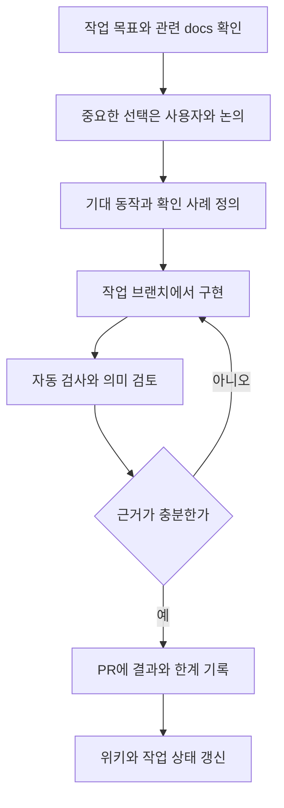

# 개발 작업 흐름

상태: 합의한 운영 방향을 적용하는 첫 버전. 실제 사용에서 불필요한 절차는 줄입니다.

목표는 에이전트가 필요한 기준을 찾고, 결과를 검증하고, 실패한 작업을 복구하며 개발을 이어가는 것입니다. 자체 하네스나 별도 메모리 엔진을 기본 전제로 두지 않습니다.

## 작업 순서

1. **시작:** [작업 상태](work-state.md), [위키](wiki/index.md), 관련 기준 문서를 읽습니다. 합의한 내용·가설·제안을 구분합니다.
2. **목표:** 해결할 문제, 기대 결과, 변경 범위를 정합니다. 중요한 선택은 추천안과 이유를 먼저 제시하고 함께 정합니다. 사소한 구현 선택에는 승인을 반복 요청하지 않습니다.
3. **확인 사례:** 위험과 불확실성에 맞는 사례를 정합니다. 실제 공시의 정답은 원문으로 확인하고 코드 출력으로 만들어내지 않습니다.
4. **구현:** 브랜치에서 하나의 목적을 구현합니다. 현재 필요한 책임부터 나누고 예상만으로 범용 구조를 만들지 않습니다.
5. **검증:** 가능한 자동 검사를 실행하고, [정합성 검토](consistency.md)로 설명과 동작을 대조합니다.
6. **작업 마무리:** PR에 실제 검사 결과와 확인하지 못한 내용을 남깁니다. 작업 상태에는 다음 행동을, 위키에는 달라진 참조만 갱신합니다.

## 브랜치와 변경 기록

| 항목 | 사용 방식 |
|---|---|
| main | 검사를 통과한 변경을 PR로 반영하는 기준 브랜치 |
| 작업 브랜치 | docs/주제, feat/주제, fix/주제, chore/주제 |
| 이슈 | 논의가 필요하거나 여러 작업으로 이어질 때 작성. 작은 수정에는 생략 가능 |
| 커밋 | 목적이 드러나는 짧은 한국어. 하나의 논리적 변경 단위 |
| PR | 변경 이유, 관련 docs, 검증, 남은 문제를 설명 |
| 결정 기록 | 영향이 큰 선택의 이유·대안·재검토 조건을 보존 |

타인 승인이나 엄격한 커밋 접두사는 필수화하지 않습니다. 사용자와의 중요한 설계 합의는 유지합니다. 이 문서는 운영 규칙이며 저장소 보호 설정을 자동 활성화하지 않습니다.

## 검사와 리뷰

CI는 문서 빌드와 첫 단위 변환 코드의 린트·타입·테스트를 검사합니다. 추가 조회 기능이 생기면 계약·실제 공시 회귀 테스트를 해당 변경에 추가합니다. 실제 API·모델 연동 검사는 외부 장애·비용을 고려해 구분합니다.

테스트 통과가 도메인 정확성을 보장하지는 않습니다. 정답 데이터·기대 결과·검사 제외·CI 완화 변경은 PR에서 이유를 별도로 설명합니다. 관련 실패를 재현하지 않는 약한 테스트나 구현을 그대로 복사한 테스트를 경계합니다.

안티패턴은 실제 문제에서 보강합니다. 실패 사례를 확보하고 원인을 수정한 뒤, 정적 패턴이면 린트·구조 검사로, 동작 문제면 테스트로 남깁니다. 규칙에는 올바른 대안을 함께 안내하고 효과 없는 규칙은 제거합니다. 과도한 추상화는 이름·줄 수만으로 판정하지 않습니다.

## 복구와 관측

Git 차이·커밋·PR·CI 결과와 작업 상태를 우선 활용합니다. 실패 원인과 재시도 결과를 필요한 범위에서 남기되 비밀값·내부 법인 자료·전체 대화를 공개 기록에 복사하지 않습니다. 사용자 변경을 삭제하지 않고, 되돌릴 때는 해당 변경의 영향과 복구 방법을 확인합니다.

## 평가를 분리합니다

| 개발 에이전트 평가 | DART 조회 평가 |
|---|---|
| docs 준수, 회귀, 규칙 우회, 복구와 리뷰 비용 | 법인·문서·기간·단위·금액 정확성, 누락, 잘못된 확정, 보류 |

초기에는 작업별 사례를 기록합니다. 측정할 작업 집합과 정답이 없는 상태에서 성공률이나 신뢰도 점수를 만들지 않습니다. 모델·조건이 다른 실행을 단순 비교하지 않습니다.

## 템플릿

[이슈 템플릿](https://github.com/YUJAEYUN/Dartness/blob/main/.github/ISSUE_TEMPLATE/work.md)과 [PR 템플릿](https://github.com/YUJAEYUN/Dartness/blob/main/.github/pull_request_template.md)은 짧은 안내입니다. 의미 없는 칸은 생략할 수 있습니다. [설계 결정 양식](record-forms/decision.md)은 중요한 선택에만 사용합니다.

## 참고

[dev-notes](https://github.com/YUJAEYUN/dev-notes)의 요구사항 중심·근거 있는 선택·영향에 맞춘 검증 원칙을 이 프로젝트에 필요한 범위에서 적용합니다. 에이전트가 필요한 정보를 찾고 결과를 검증·복구하게 한다는 논의 내용을 운영 흐름으로 구체화했습니다. 논의에서 인용된 출처 불명의 연구 주장은 채택하지 않았습니다.

## 여러 에이전트의 공동 작업 — 아직 정하지 않은 내용

실제 다중 에이전트 실행은 아직 설정하지 않았습니다. 공동 작업이 필요할 때 적용할 아래 방식은 사용자와 논의할 제안입니다.

- 작업마다 별도 브랜치와 작업 디렉터리 또는 worktree를 사용합니다. 브랜치만 나누고 같은 작업 디렉터리를 공유하면 작업 파일이 격리되지 않습니다.
- 작업 범위와 공통 계약을 먼저 정합니다. 동일한 핵심 파일·계약의 동시 수정은 피하고, 필요하면 작업을 순차 실행합니다.
- 각 PR이 통과해도 조합 후 동작은 달라질 수 있습니다. 최신 main을 반영한 통합 결과에서 관련 테스트를 다시 실행합니다.
- 통합 담당자는 전체 목표·문서·위키·구현의 관계를 확인합니다. 담당자가 코드를 모두 작성할 필요는 없습니다.
- 텍스트 충돌이 없더라도 의미 충돌이 있을 수 있습니다. 인터페이스·단위·상태·공통 설정 변경을 함께 점검합니다.
- docs 원본이나 공통 스키마 변경은 다른 작업자에게 전달하고 영향받는 작업의 기준을 갱신합니다. 위키·작업 상태를 여러 에이전트가 동시에 덮어쓰지 않습니다.
- GitHub의 필수 검사·최신 브랜치 요구 또는 merge queue는 규모와 권한에 맞춰 검토합니다. 현재 저장소에는 이 문서로 자동 설정되지 않습니다.

처음에는 순차 통합으로 시작합니다. 병합 충돌을 없애기 위해 서비스를 쪼개거나 분산 락·별도 조정 서버를 먼저 만들지 않습니다.

## CI와 병합 후 정리

[검사와 보호 설정](ci.md)을 따릅니다. 병합한 작업 브랜치는 삭제하며 main은 유지합니다. 로컬 작업은 미커밋 변경과 다른 작업의 사용 여부를 먼저 확인합니다.
