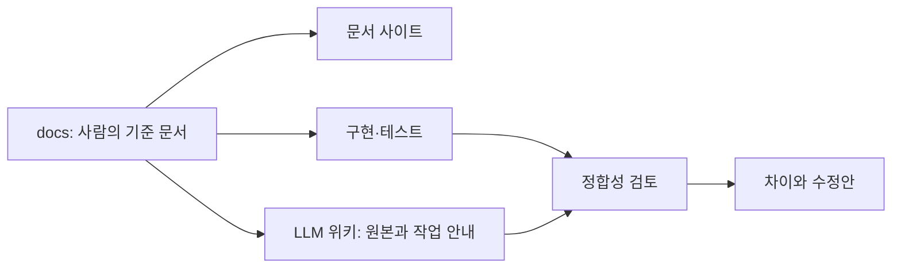

# 문서 운영과 메모리

## 최상위 기준

프로젝트의 사람이 읽는 `docs/`가 요구사항과 설계의 기준입니다. 코드와 다르면 코드를 정답으로 간주해 문서를 덮어쓰지 않습니다. 구현 오류인지, 문서 변경이 필요한지 근거로 판단합니다.



## 원본과 위키

[LLM 위키 진입점](wiki/index.md)은 같은 원본으로 연결합니다. 모든 문서를 한꺼번에 컨텍스트에 넣지 않고 작업에 필요한 문서를 선택합니다. [작업 상태](work-state.md)는 목표·미결 사항·다음 행동을 담고, 대화 전체를 복제하지 않습니다.

개인 자동 메모리는 보조 정보입니다. 프로젝트 규칙으로 채택하려면 원문·코드·테스트 등으로 확인하고 docs에 반영합니다. 확인한 사실과 가설을 구분합니다.

## Claude Code의 기본 기능과 연구 아이디어

2026-11-19 확인한 [Claude Code 메모리 문서](https://code.claude.com/docs/en/memory)는 CLAUDE.md/AGENTS.md와 자동 메모리를 설명합니다. 이 기능들은 컨텍스트이며 강제 검사 설정이 아닙니다. 설치 버전·설정에 따른 실제 동작은 별도로 확인해야 합니다.

[Anthropic 메모리 연구](https://www.anthropic.com/research/components-of-agent-memory)는 기록, 메모, 위키 같은 표현, 세션에 주입할 컨텍스트를 구분하고 재검토로 메모를 개선하는 접근을 설명합니다. 연구 전체가 Claude Code에 자동 탑재되었다고 단정하지 않습니다.

Dartness에는 가벼운 원본 지도와 작업 상태부터 적용합니다. 자체 메모리 엔진이나 LLM 예약 실행은 추가하지 않았습니다. 주기적 의미 검토 방식은 앞으로 함께 결정합니다.

## 변경 시 점검

1. 관련 요구사항과 설계 문서를 읽습니다.
2. 구현·테스트·예시와의 차이를 확인합니다.
3. 문서나 코드 중 어느 쪽을 고칠지 이유를 남깁니다.
4. 위키 참조와 작업 상태를 필요한 범위에서 갱신합니다.
5. 문서 빌드를 실행합니다.

## 자동 검사 범위와 한계

CI는 엄격한 문서 빌드로 탐색 구성·내부 문서 링크를 검사합니다. Mermaid 구문 렌더링, 외부 링크의 최신 상태, 설명과 구현의 의미 일치까지 보장하지 않습니다.

주간 예약 작업은 문서 빌드를 다시 실행합니다. 의미 차이는 에이전트·사람이 확인하며 자동 덮어쓰기는 하지 않습니다. 아직 조회 엔진이 없어 코드 계약 정합성 검사는 구현하지 않았습니다.

## 로컬 사용과 게시

```bash
python -m venv .venv
.venv/bin/pip install -r requirements-docs.txt
.venv/bin/mkdocs serve
# 검증
.venv/bin/mkdocs build --strict
```

Windows에서는 `.venv/Scripts/`의 실행 파일을 사용합니다.

GitHub Pages 게시 워크플로는 수동 실행입니다. 저장소 Settings → Pages에서 Source를 GitHub Actions로 설정한 뒤 `Publish docs`를 실행합니다. 게시 작업은 공개 docs만 포함하므로 내부 법인 목록·조회 결과·키를 문서 폴더에 넣지 않습니다. 아직 사이트가 게시됐다고 가정하지 않습니다.

## 개발 흐름과 정합성 기록

[작업 흐름](development-workflow.md)과 [정합성 검토](consistency.md)를 따릅니다. 규칙 식별자는 중요한 항목에만 붙이고, 구현되지 않은 것은 미구현으로 남깁니다. 주간 빌드는 의미 정합성 검토를 대신하지 않습니다.

## 읽기 쉬운 문장

사람이 읽는 문서와 템플릿은 개발 현장에서 익숙한 용어와 자연스러운 한국어로 씁니다. 질문은 “무엇을 바꿨나요?”처럼 직접 쓰고, 단어만 나열하지 않습니다. 정확한 기술 용어는 유지하되 필요한 설명을 붙입니다.

예를 들어 “검토할 제안”은 “아직 정하지 않은 내용”, “미확인 범위”는 “확인하지 못한 내용”으로 표현할 수 있습니다. 문맥에 따라 더 자연스러운 표현을 선택합니다.

자동 검사는 깨진 링크나 이미 확인한 어색한 표현을 찾는 데 사용할 수 있지만, 문장이 자연스럽고 이해하기 쉬운지는 보장하지 못합니다. 실제 독자의 피드백과 예시를 함께 검토합니다. 한국어 문장 길이·명사 수·LLM 점수만으로 CI를 차단하지 않습니다. 언어 검사 도구는 아직 추가하지 않았습니다.
